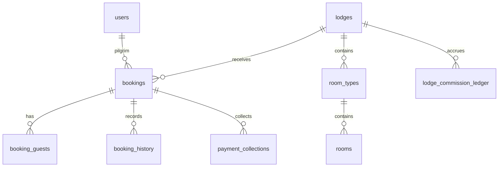

# Live database architecture

Verified 2026-10-28 through read-only Supabase SQL metadata, project heypsutewmttbscuwqje. PostgreSQL 17 reported by project discovery. This is a structural snapshot, not a backup or evidence of row-level correctness.

Full columns, types, nullability, defaults, constraint definitions, indexes, trigger names and migration records are saved in [live-schema-metadata.json](live-schema-metadata.json). No personal record contents are included.

67 public relations represented by information_schema.columns; 721 columns, 233 constraints, 277 indexes, nine trigger entries. Views appear alongside tables in this inventory.

| Relation | Columns |
|---|---:|
| _prisma_migrations | 8 |
| account_flags | 9 |
| admin_totp_credentials | 6 |
| amenities | 9 |
| analytics_daily | 11 |
| announcement_reads | 6 |
| announcements | 15 |
| audit_logs | 8 |
| auth_identities | 8 |
| booking_conversations | 4 |
| booking_guests | 16 |
| booking_history | 10 |
| booking_locks | 14 |
| booking_messages | 5 |
| booking_qr_tokens | 13 |
| booking_tax_details | 9 |
| bookings | 41 |
| cancellation_policies | 10 |
| cities | 9 |
| data_requests | 10 |
| device_tokens | 9 |
| feature_flags | 7 |
| festival_pricing_rules | 12 |
| guest_id_documents | 10 |
| guest_id_proof_uploads | 9 |
| guest_register | 30 |
| lodge_addresses | 12 |
| lodge_amenities | 4 |
| lodge_commission_balances | 8 |
| lodge_commission_ledger | 18 |
| lodge_commission_reconciliation | 8 |
| lodge_commission_settings | 9 |
| lodge_commission_settlement_allocations | 5 |
| lodge_commission_settlements | 10 |
| lodge_documents | 13 |
| lodge_owners | 13 |
| lodge_photos | 17 |
| lodge_verification_logs | 7 |
| lodges | 22 |
| notification_delivery_logs | 14 |
| notification_preferences | 7 |
| notification_templates | 9 |
| notifications | 18 |
| otp_requests | 12 |
| owner_bank_details | 10 |
| password_reset_tokens | 10 |
| payment_collections | 13 |
| payment_settings | 6 |
| promo_codes | 14 |
| promo_redemptions | 6 |
| qr_scan_logs | 13 |
| refresh_tokens | 8 |
| register_audit_logs | 7 |
| review_owner_responses | 6 |
| review_reports | 10 |
| reviews | 17 |
| room_availability | 7 |
| room_pricing | 7 |
| room_status_history | 8 |
| room_types | 14 |
| rooms | 10 |
| staff_role_assignments | 5 |
| support_ticket_messages | 5 |
| support_tickets | 11 |
| system_settings | 7 |
| user_sessions | 13 |
| users | 10 |

Core relationships follow foreign keys in the metadata: users own bookings; lodges contain room_types and rooms; bookings connect pilgrim, lodge, room type and optional room; booking_guests, history, QR and guest register track the stay. Payment collections and lodge commission ledger/settlement allocation tables track separate financial records. See booking/payment audit for transactional boundaries.

Diagram covers core relationships only; exact nullable keys and deletion behavior are authoritative in JSON constraints. RLS/grants observation is recorded in AUDIT_STATUS.md. Pending: functions/view definitions, enum values, all grants/policies, bucket ACLs, aggregate duplicate/orphan/overlap checks, retention and backup verification, and comprehensive ORM-to-live comparison.

